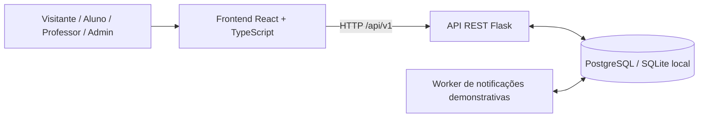

<div align="center">

# LearnPlay

**Aprender abre caminhos.**

Plataforma web de cursos online com catálogo, matrículas, aulas, avaliações e acompanhamento de progresso. A trilha de Python inclui uma prévia interativa. As trilhas de Python e Git/GitHub têm missões com tempo sugerido e critérios de conferência. Em **Meus cursos**, cada matrícula ativa indica a aula que será aberta ao começar, continuar ou revisar.

[](https://github.com/saleslima567-dotcom/Learn-Play/actions/workflows/quality.yml)


**[Acessar demonstração](https://learnplay-lzk9.onrender.com/)** · **[Arquitetura](./01_Passo_1_Arquitetura.md)** · **[Contrato da API](./contratos/openapi.yaml)**

</div>

---

## Sobre o projeto

O **LearnPlay** é um protótipo acadêmico de plataforma de aprendizagem online. A aplicação reúne o fluxo de quem procura um curso, acompanha aulas e conclui atividades com as ferramentas de quem cria conteúdos e administra a plataforma.

O projeto inclui uma **SPA em React** e uma **API REST em Flask**, com persistência em banco de dados, autorização por perfil e funcionalidades demonstrativas de matrícula e aprendizagem. A interface utiliza uma identidade em **vinho e grafite**, com alternância entre temas claro e escuro e ajustes de acessibilidade.

> **Importante:** o projeto é uma demonstração funcional, não um serviço comercial. O pagamento, o player de vídeo e o envio de notificações externas são simulados. Nenhuma cobrança real é processada.

## Funcionalidades

| Perfil | Recursos disponíveis |
| --- | --- |
| **Visitante** | Explorar o catálogo, buscar cursos e aulas publicadas, combinar objetivo e nível, consultar etapas de uma trilha e experimentar a lista de tarefas do projeto de Python. |
| **Aluno** | Cadastrar-se, entrar, matricular-se, salvar favoritos, retomar aulas, registrar conclusões, acompanhar progresso, responder avaliações e emitir certificado imprimível quando elegível. |
| **Professor** | Criar rascunhos de cursos, adicionar aulas, configurar avaliação e publicar cursos válidos. |
| **Administrador** | Consultar usuários, alterar perfis, suspender ou reativar contas e excluir contas de aluno com confirmação. |

### Experiência de aprendizagem

- **Matrículas:** cursos gratuitos com ativação e cursos pagos com confirmação **demonstrativa**.
- **Progresso persistido:** conclusão de aula idempotente, percentual calculado no backend e retomada da última aula acessada.
- **Avaliações:** tentativas limitadas e correção realizada no servidor.
- **Painel do aluno:** cursos em andamento e gráfico de conclusão alimentado pelos dados das matrículas ativas.
- **Interface:** responsividade, temas claro/escuro, estados de foco, animações leves e respeito à preferência por movimento reduzido.
- **Notificações na interface:** avisos de ações e erros apresentados ao usuário.

## Tecnologias

| Camada | Tecnologias |
| --- | --- |
| **Frontend** | React 19, TypeScript, Vite 8, HTML e CSS |
| **Componentes e visual** | Tailwind CSS 4, componentes shadcn/ui, Lucide React |
| **Interações** | Motion, Sonner |
| **Dados e formulários** | TanStack Query (catálogo), React Hook Form, Zod |
| **Gráficos** | Recharts (carregado sob demanda no painel do aluno) |
| **API** | Python 3.12, Flask, Flask-SQLAlchemy, SQLAlchemy |
| **Persistência** | PostgreSQL no Docker Compose/Render; SQLite na execução local e nos testes |
| **Infraestrutura e qualidade** | Docker, Docker Compose, Render, GitHub Actions e pytest |

> As bibliotecas são integradas de forma incremental: o **TanStack Query** atende atualmente ao catálogo, e os componentes shadcn/ui não substituem toda a interface original.

## Arquitetura implementada



O frontend chama a API pelo prefixo `/api/v1`. No **Render**, o `Dockerfile` da raiz compila o frontend com Vite; o Flask entrega os arquivos estáticos e a API no mesmo serviço. No **Docker Compose**, o frontend Vite, a API, o PostgreSQL e o worker executam em serviços separados.

O código do protótipo mantém parte das regras e dos modelos concentrada em `backend/learnplay/app.py`. Os documentos de arquitetura descrevem também a **estrutura-alvo**, que não deve ser confundida com todos os componentes já implementados.

### Estrutura principal

```text
Learn-Play/
├── .github/workflows/quality.yml   # Build e testes automatizados
├── frontend/
│   ├── src/
│   │   ├── components/              # Páginas de catálogo e componentes de UI
│   │   ├── features/                # Painel e gráfico de progresso
│   │   ├── motion/                  # Comportamento de animações
│   │   ├── main.tsx                 # Aplicação React e navegação
│   │   ├── model.ts                 # Tipos de domínio compartilhados
│   │   ├── style.css                # Estilos base e responsividade
│   │   └── design-refresh.css       # Identidade visual vinho/grafite
│   └── package.json
├── backend/
│   ├── learnplay/app.py             # Modelos, regras e endpoints Flask
│   ├── tests/test_api.py            # Testes da API
│   ├── init_db.py                   # Inicialização de dados e esquema
│   ├── worker.py                    # Outbox demonstrativa
│   └── wsgi.py
├── contratos/openapi.yaml          # Contrato da API
├── diagramas/                      # Diagramas Mermaid
├── adrs/                           # Registros de decisões arquiteturais
├── compose.yaml                    # Ambiente local com PostgreSQL
├── Dockerfile                      # Build de produção
└── render.yaml                     # Configuração do Render
```

## Como executar

### Opção 1 — Docker Compose

**Pré-requisito:** Docker com Docker Compose.

Na raiz do repositório:

```bash
git clone https://github.com/saleslima567-dotcom/Learn-Play.git
cd Learn-Play
cp .env.example .env
docker compose up --build
```

No Windows PowerShell, substitua `cp .env.example .env` por `Copy-Item .env.example .env`.

| Serviço | Endereço local |
| --- | --- |
| **Aplicação** | [http://localhost:5173](http://localhost:5173) |
| **Health check da API** | [http://localhost:5000/api/v1/health/ready](http://localhost:5000/api/v1/health/ready) |

Os valores de `.env.example` são **apenas para desenvolvimento local**. Troque as credenciais e os segredos antes de utilizar um ambiente compartilhado.

Para encerrar:

```bash
docker compose down
```

**Atenção:** `docker compose down -v` também remove os volumes locais, incluindo os dados do PostgreSQL usados pelo Compose.

### Opção 2 — Sem Docker

**Pré-requisitos:** Node.js 24+, Python 3.12+ e npm.

Inicie a API no primeiro terminal:

```powershell
cd backend
python -m venv .venv
.\.venv\Scripts\Activate.ps1
python -m pip install -r requirements.txt
python wsgi.py
```

Em outro terminal, na raiz do repositório:

```bash
cd frontend
npm ci
npm run dev
```

Acesse [http://localhost:5173](http://localhost:5173). O Vite encaminha `/api` para `http://localhost:5000`. Sem Docker, a aplicação usa **SQLite local**.

### Contas de demonstração

Quando os dados de demonstração estão habilitados (`SEED_DEMO=true`), existem perfis de aluno, professor e administrador. Em ambiente local, a tela de login apresenta credenciais demonstrativas.

No Render, as senhas dos perfis de teste são configuradas pelas variáveis `DEMO_STUDENT_PASSWORD`, `DEMO_INSTRUCTOR_PASSWORD` e `DEMO_ADMIN_PASSWORD`. **Não publique senhas, arquivos `.env` ou segredos no repositório.**

## Testes e integração contínua

O GitHub Actions executa automaticamente a compilação do frontend e os testes da API em pull requests e atualizações da branch `main`.

**Frontend:**

```bash
cd frontend
npm ci
npm run build
```

**Backend:**

```bash
cd backend
python -m pip install -r requirements.txt
python -m pytest -q
```

Veja o resultado das execuções em **[LearnPlay Quality](https://github.com/saleslima567-dotcom/Learn-Play/actions/workflows/quality.yml)**.

> O build e os testes existentes não substituem testes de interface em dispositivos reais, testes de carga ou avaliações de segurança completas.

## Demonstração e implantação

**[Abrir o LearnPlay no Render](https://learnplay-lzk9.onrender.com/)**

A implantação do protótipo usa `render.yaml` e o `Dockerfile` da raiz. O serviço compila React/Vite, executa a API Flask com Gunicorn e pode usar PostgreSQL gerenciado. O worker externo de notificações não faz parte da configuração básica gratuita do serviço web.

Para criar outra implantação, conecte o repositório ao Render e configure as variáveis de ambiente exigidas pelo Blueprint. O nome técnico dos recursos no `render.yaml` pode diferir da marca **LearnPlay** exibida na interface.

## Limitações e próximos passos

**Demonstrativo atualmente:**

- **Pagamentos:** confirmação simulada; não há gateway ou cobrança real.
- **Vídeos:** interface de player ilustrativa; não há streaming nem armazenamento S3 conectado.
- **Notificações:** o worker processa uma outbox demonstrativa, mas não envia e-mails reais.
- **Banco:** a inicialização do esquema não substitui migrações versionadas.
- **Produção:** disponibilidade, desempenho sob carga, backup e recuperação não foram validados para operação comercial.

**Possíveis evoluções:** testes automatizados de ponta a ponta, migrações versionadas, integrações reais de mídia e pagamento, melhoria contínua da acessibilidade e otimização do bundle de frontend.

## Documentação acadêmica e técnica

| Arquivo | Conteúdo |
| --- | --- |
| [Passo 1 — Arquitetura](./01_Passo_1_Arquitetura.md) | Contexto, requisitos e decisões iniciais |
| [Passo 2 — Documentação](./02_Passo_2_Documentacao.md) | Visões, componentes, contratos e decisões de arquitetura |
| [Passo 3 — Protótipo](./03_Passo_3_Prototipo.md) | Implementação e validação do protótipo acadêmico |
| [Contrato OpenAPI](./contratos/openapi.yaml) | Endpoints da API |
| [Diagramas](./diagramas) | Visões e fluxos em Mermaid |
| [ADRs](./adrs) | Registros de decisões arquiteturais |
| [Relatório de revisão](./RELATORIO_REVISAO_VALIDACAO.md) | Revisão e validação |
| [Matriz de rastreabilidade](./matriz_rastreabilidade.csv) | Relação entre requisitos e artefatos |

---

<div align="center">

**LearnPlay — aprender abre caminhos.**

*Protótipo acadêmico em evolução.*

</div>

## Segurança — revisão de hardening

- Limites de autenticação e criação de sessão por janela de 10 minutos, armazenados no banco compartilhado. Login também tem limite por conta. Não substitui proteção de borda contra DDoS; confirme a topologia de proxies antes de configurar `TRUST_PROXY_HOPS` (0 por padrão).
- Corpo JSON de até 128 KiB, validação de objeto, campos de autenticação e respostas de avaliação; respostas 400/413/422/429 conforme o caso.
- Cabeçalhos anti-clickjacking, CSP parcial (não é política XSS completa), HSTS quando configurado para produção e cache privado desabilitado para API.
- Em produção, senhas públicas de demonstração são recusadas e sessões de contas que ainda usam essas senhas são revogadas na inicialização. Contas e registros existentes não são excluídos. **Configure credenciais exclusivas por meio das variáveis protegidas do provedor.** Uma conta que ainda utiliza a senha pública pode ser recuperada ao definir seu segredo individual no Render (16 a 128 caracteres, exclusivo e não público) e executar o deploy. A rotina troca somente senhas padrão identificadas, preserva senhas personalizadas e revoga sessões antigas. Não coloque segredos em commits, logs ou documentação. A seed em produção requer três segredos exclusivos e fortes; o Blueprint desabilita a seed por padrão.
- Tentativas de avaliação são serializadas por matrícula com bloqueio de linha no PostgreSQL. SQLite é utilizado nos testes; não oferece a mesma garantia de concorrência.
- Flask atualizado para 3.1.3 (CVE-2026-27205) e pytest para 9.0.3. O workflow de segurança executa `pip-audit` e `npm audit --audit-level=high`. Alertas moderados da cadeia shadcn/minimatch permanecem em avaliação; aprovação da CI não implica ausência de vulnerabilidades.
- Pagamentos e certificados continuam demonstrativos: não utilizar como comprovação comercial ou certificação formal.

Pendências: validar a configuração real do Render, rotação das credenciais existentes, MFA, proteção anti-bot, auditoria de dependências transitivas, testes de concorrência PostgreSQL e avaliação de CSP completa em staging.
